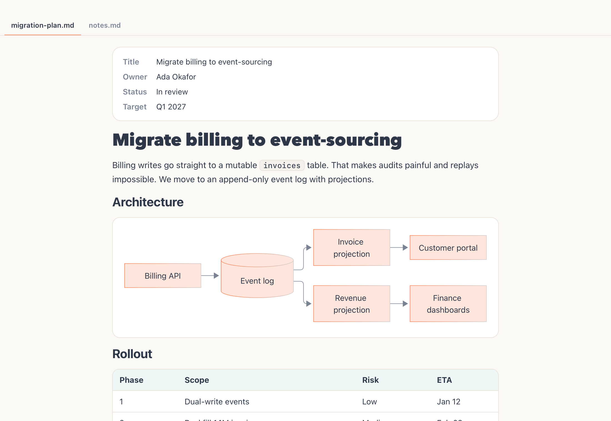
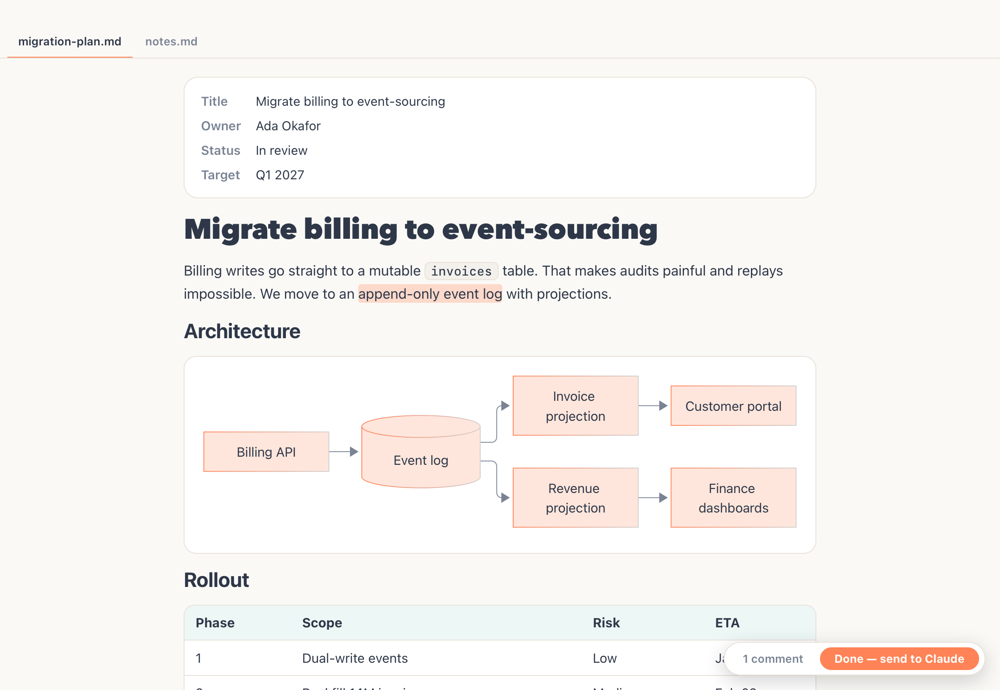
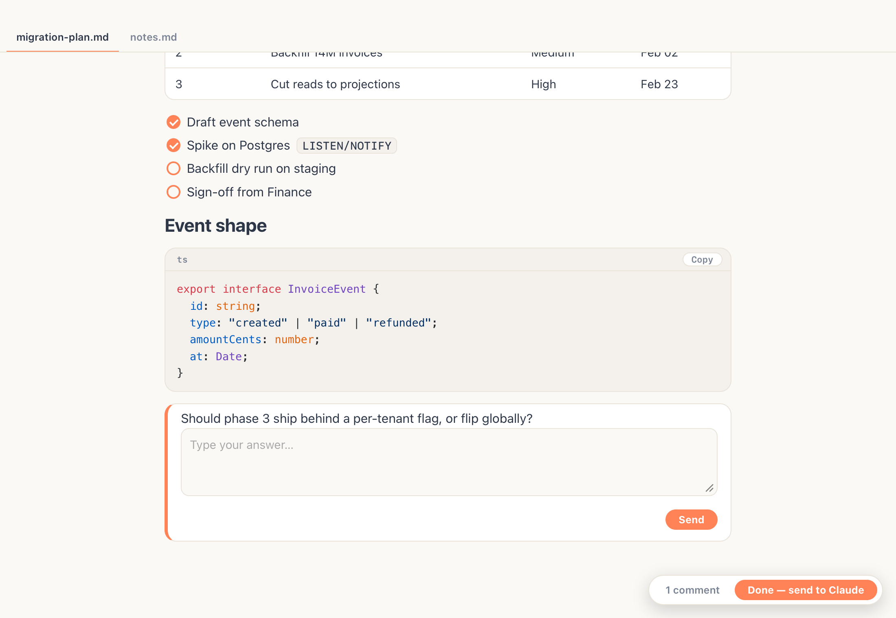
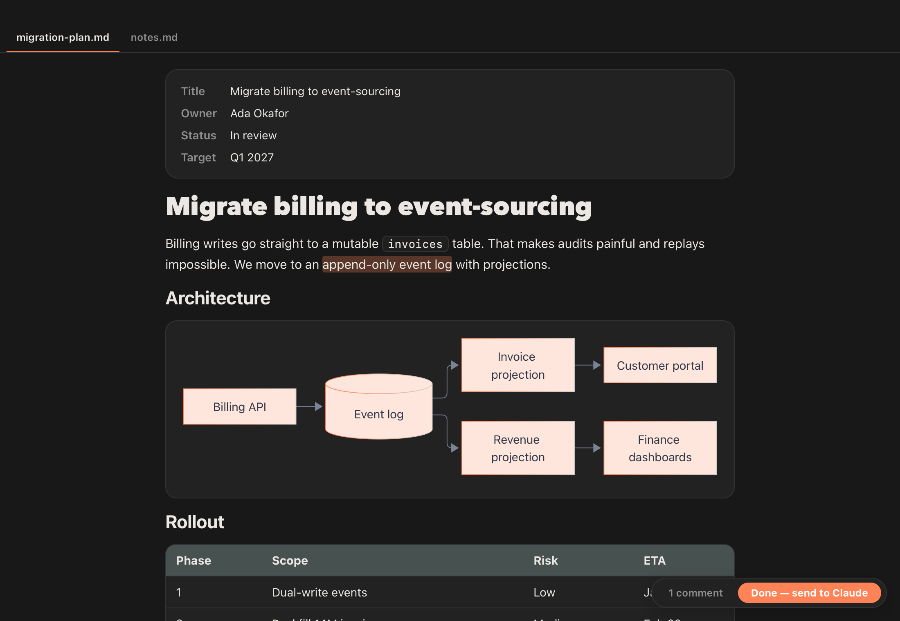

# Lantern 🏮

A tiny, view-only macOS app that renders the markdown your AI writes, live, in its own window.



## Why

Claude writes plans, specs and design docs as `.md`. Reading them as raw text in a terminal is miserable: no diagrams, no tables, no structure, and you lose your place on every edit. Lantern fixes that:

- **Renders everything**: Mermaid, tables, highlighted code, task lists, frontmatter cards, `file:line` links, light and dark.
- **Live**: edit the file and the changed blocks glow, without re-opening anything.
- **Tabs**: open a folder and every `.md` becomes a tab.
- **Two-way, without touching the file**: Claude can ask you questions inside the doc, and you can highlight any text to comment on it. Replies are stored beside the plan, never in the `.md`.

|  |  |
|---|---|
|  **Highlight → comment** |  **Claude asks, you answer** |



## Install

    ./scripts/install.sh      # builds, installs /Applications/Lantern.app + ~/.local/bin/lantern, smoke-tests
    claude mcp add --scope user lantern -- ~/.local/bin/lantern mcp

Needs macOS, Xcode and `xcodegen`.

## Use

Claude drives it through MCP tools (`lantern_open`, `lantern_switch`, `lantern_goto`, `lantern_answers`, `lantern_comments`, `lantern_window`, `lantern_screenshot`, `lantern_list`, `lantern_close`). Or use the CLI yourself:

    lantern open <file|dir>... [--focus]
    lantern switch <file|index|name>
    lantern goto <heading|text|answer-id>
    lantern answers [file] [--wait N]      # replies typed into question boxes
    lantern comments [file] [--wait N]     # highlight comments; Done marks them sent
    lantern list | close | window | snapshot <out.png>

Ask a question in a doc with a fenced block:

    ```answer q1
    Which database should we use?
    ```

## Develop

    xcodegen generate
    ./scripts/test.sh            # 42-check end-to-end suite, runs in the background
    ./scripts/demo-shots.sh      # regenerates docs/*.png from docs/demo (fake data)
