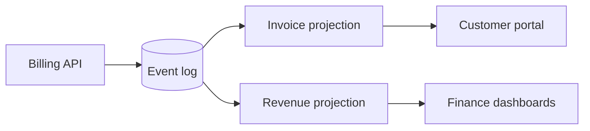

# Migrate billing to event-sourcing

Billing writes go straight to a mutable `invoices` table. That makes audits painful and replays impossible. We move to an append-only event log with projections.

## Architecture



## Rollout

| Phase | Scope | Risk | ETA |
|-------|-------|------|-----|
| 1 | Dual-write events | Low | Jan 12 |
| 2 | Backfill 14M invoices | Medium | Feb 02 |
| 3 | Cut reads to projections | High | Feb 23 |

- [x] Draft event schema
- [x] Spike on Postgres `LISTEN/NOTIFY`
- [ ] Backfill dry run on staging
- [ ] Sign-off from Finance

## Event shape

```ts
export interface InvoiceEvent {
  id: string;
  type: "created" | "paid" | "refunded";
  amountCents: number;
  at: Date;
}
```

```answer q1
Should phase 3 ship behind a per-tenant flag, or flip globally?
```
