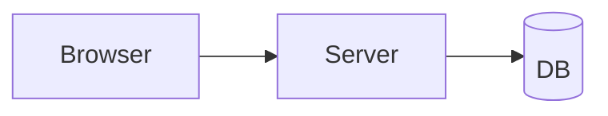

# Add OAuth login

A short plan to add **OAuth** login. See `src/auth/login.ts:42` and src/server.ts:118-130 for the entry points.

## Approach

1. Add a provider table
2. Implement the callback route
3. Wire sessions

> Note: tokens are stored encrypted at rest.

### Code

```ts
export async function login(req: Request) {
  const token = await exchange(req.query.code);
  return session(token);
}
```



## Tasks

- [x] Design the schema
- [x] Spike the provider SDK
- [ ] Implement callback
- [ ] Write tests

## Risks

| Risk | Likelihood | Mitigation |
|------|-----------|------------|
| Token leak | Low | Encrypt at rest |
| Provider outage | Medium | Fallback to password |
